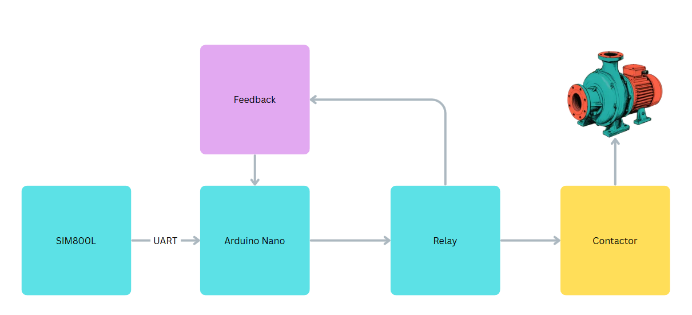

# 💧 Remote Water Pump Controller — GSM/SMS Based

**A hardware and firmware project for remotely controlling a water pump over GSM/SMS.**

Designed for field use, this embedded system provides remote pump control, timed operation, status monitoring, and error notifications without requiring an internet connection.

  
  

  <em>Field installation and custom-developed control electronics</em>

---

## System

An Arduino Nano receives SMS commands through a SIM800L GSM module, checks the sender against a list of authorized phone numbers, and controls the pump through a relay. Pump feedback lets the firmware compare the commanded relay state with the reported operating state.

  

  <em>System architecture — from SMS reception to pump control</em>

### Key capabilities

- Remote pump control wherever GSM coverage is available
- Timed operation with automatic shutoff
- Phone-number authorization for incoming commands
- SMS status requests and configurable confirmations
- Relay and pump-feedback monitoring with error notifications

---

## Hardware

The controller combines a custom PCB with an Arduino Nano, SIM800L module, power regulation, relay driver, and pump feedback connections.

For circuit diagrams and a component-level overview, see [Hardware Overview](doc/HardwareOverview.md).

### PCB design

  

The custom PCB integrates the control and communication electronics into a compact assembly for installation in a protective enclosure.

### Electrical safety

The controller interfaces with a 220 V AC installation. Mains wiring, protective devices, contactor selection, enclosure design, and installation must comply with applicable electrical safety requirements. Hazardous voltages must be properly isolated from low-voltage control electronics.

---

## Firmware

The Arduino firmware is in the [`firmware/`](firmware/) directory. The sketch entry point delegates to separate controller and SMS-service modules. See [Software Flow](doc/SoftwareFlow.md) for the firmware structure and execution flow.

**Platform and technologies:**

- Arduino Nano / ATmega328P
- Embedded C/C++
- SIM800L GSM module and `SoftwareSerial`
- SMS parsing, sender authorization, and command handling
- Timer management, pump-state monitoring, and watchdog support

### SMS command reference

Send commands to the SIM800L module's SIM card number. Commands are accepted only from configured authorized phone numbers.

| SMS command | Description | Example |
|---|---|---|
| `ONmmm` | Turn the pump on for a specified number of minutes. | `ON030` — run for 30 minutes |
| `ONX` | Turn the pump on for continuous operation. | `ONX` |
| `OFF` | Turn the pump off. | `OFF` |
| `CH` | Request the current relay and pump status. | `CH` |
| `N1` | Enable SMS confirmation notifications. | `N1` |
| `N0` | Disable SMS confirmation notifications. | `N0` |

The status response reports relay state, pump feedback, and remaining time when a timed run is active. Unexpected relay and feedback combinations can trigger an error notification.

---

## Engineering scope

This project demonstrates:

- Hardware, circuit, and PCB development
- Embedded C/C++ and GSM/SMS communication
- Command parsing and access control
- Timer-based control, state monitoring, and fault detection
- Hardware/software integration for field deployment
