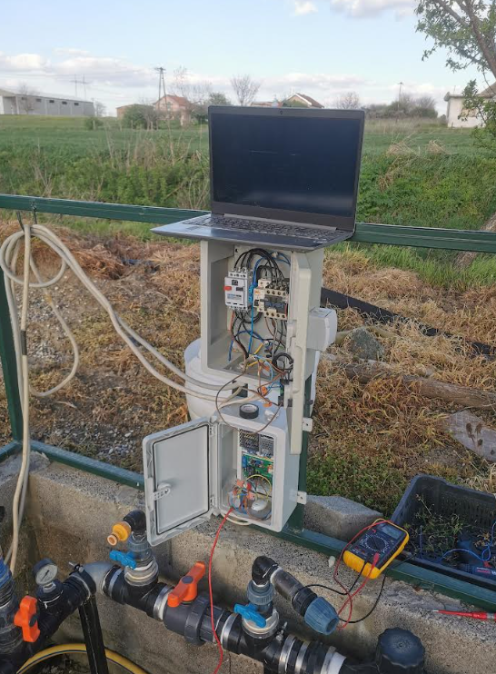
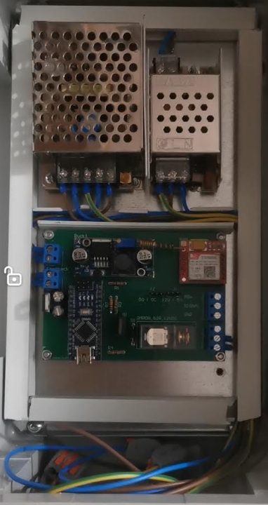
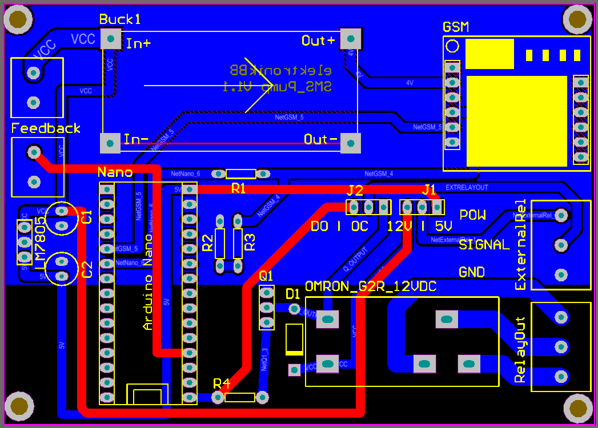

# 💧 Remote Water Pump Controller — GSM/SMS Based

**A complete hardware and firmware development project for remote water pump control via GSM/SMS.**

Designed for field deployment, this embedded system enables remote pump operation, timer-based control, status monitoring, and error notifications without requiring a local internet connection.

  
  

  <em>Field installation and custom-developed control electronics</em>

---

## 🏗️ System Overview

The controller uses a SIM800L GSM module to receive SMS commands and an Arduino Nano to process messages, validate authorized phone numbers, and execute pump control operations.

A relay-controlled contactor switches the pump's 220 V AC power circuit, while the firmware handles command parsing, timer management, status verification, error notifications, and automatic recovery.

  

  <em>System architecture — from SMS reception to pump control</em>

---

### 🔌 Circuit Schematic

The schematic shows the electronic design connecting the microcontroller, GSM module, power regulation, and relay driver.

  

## 📱 SMS Command Reference

The controller is operated by sending SMS messages to the SIM800L module's SIM card number. Commands are accepted only from preconfigured authorized phone numbers.

| SMS Command | Description | Example |
|---|---|---|
| `ON[mmm]` | Turn the pump ON for a specified number of minutes | `ON030` — run for 30 minutes |
| `ONX` | Turn the pump ON continuously | `ONX` |
| `OFF` | Turn the pump OFF | `OFF` |
| `CH` | Request current system status | `CH` |
| `N1` | Enable SMS confirmation notifications | `N1` |
| `N0` | Disable SMS confirmation notifications | `N0` |

The status response provides information about the relay state, remaining timer duration, and available pump feedback. If an unexpected state is detected, the controller can send an error notification.

## ✨ Key Features

- **Remote Control:** Operate the pump from anywhere with GSM coverage.
- **Timer-Based Operation:** Automatically stop the pump after a configured runtime.
- **Authorized Access:** Validate incoming commands against preconfigured phone numbers.
- **Status Monitoring:** Check the current operating state remotely.
- **Error Detection:** Identify discrepancies between commanded and reported states.
- **SMS Notifications:** Configure confirmation messages and receive error alerts.
- **Automatic Recovery:** Restart the controller if firmware execution becomes unresponsive.
- **Custom Hardware:** Dedicated PCB integrating power regulation, GSM communication, microcontroller control, and relay driving.

---

## ⚙️ Firmware

The complete Arduino firmware is available in the [`firmware/`](firmware/) directory.

**Main technologies:**
- Arduino Nano / ATmega328P
- Embedded C/C++
- SIM800L GSM module
- UART communication using `SoftwareSerial`
- SMS parsing and command handling
- Timer management and watchdog recovery

## 🛠️ PCB Design

  

The custom PCB integrates the main control and communication electronics into a compact assembly suitable for installation in a protective enclosure.

## ⚠️ Electrical Safety

The controller interfaces with a 220 V AC installation. Mains wiring, protective devices, contactor selection, enclosure design, and installation must comply with applicable electrical safety requirements. Hazardous voltages must be properly isolated from low-voltage control electronics.

## 🎯 Engineering Scope

This project demonstrates practical experience in:

- Complete hardware and firmware development
- Electronic circuit design and PCB development
- Embedded C/C++ programming
- GSM/SMS communication and UART interfacing
- Command parsing and access control
- Timer-based control and state monitoring
- Fault detection and watchdog recovery
- Hardware/software integration and field deployment

## ✨ Key Features

- **SMS Remote Control:** Turn the pump ON or OFF remotely.
- **Timer-Based Operation:** Configure timed operation using commands such as `ON030`, or continuous operation using `ONX`.
- **Status Monitoring:** Query relay state, remaining timer duration, and available pump feedback using `CH`.
- **Phone Number Authentication:** Accept commands only from preconfigured authorized phone numbers.
- **Feedback and Error Handling:** Detect discrepancies between commanded and reported operating states and send warning SMS messages.
- **Configurable Notifications:** Enable or disable confirmation messages using `N1` and `N0`.
- **Watchdog Recovery:** Automatically restart the controller if firmware execution becomes unresponsive.

---

