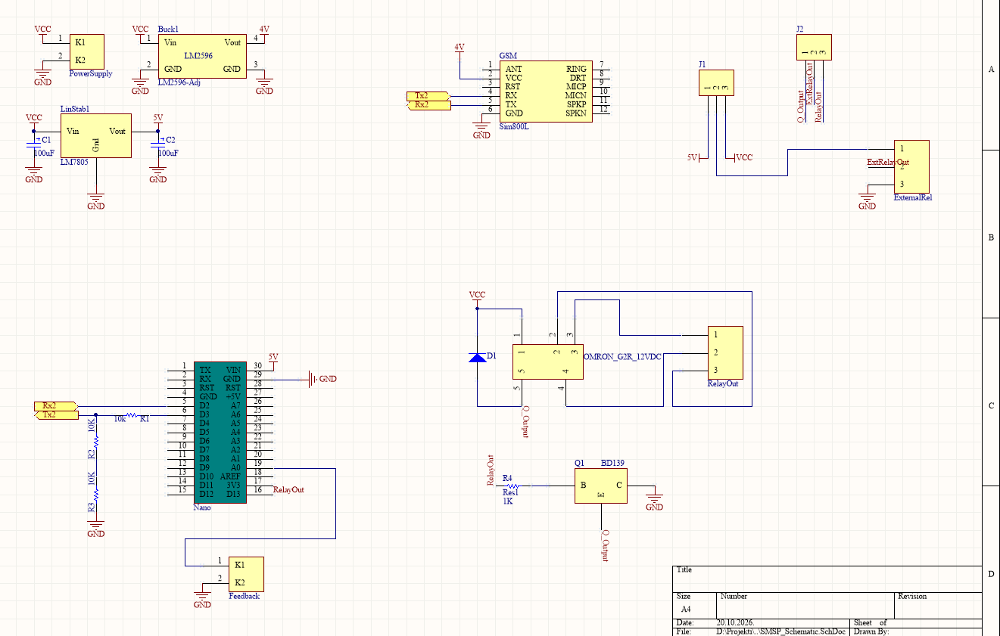
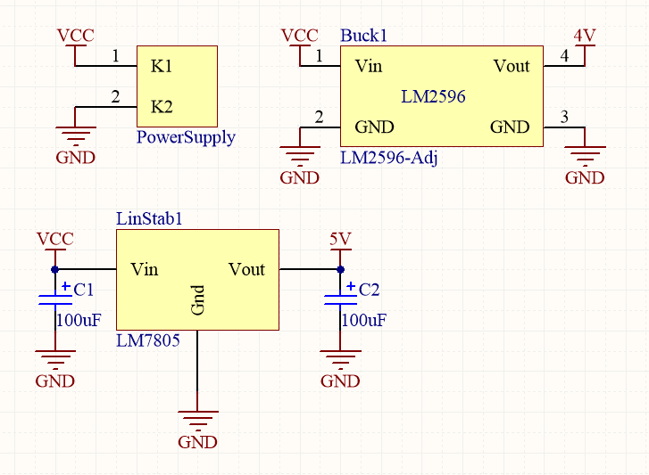
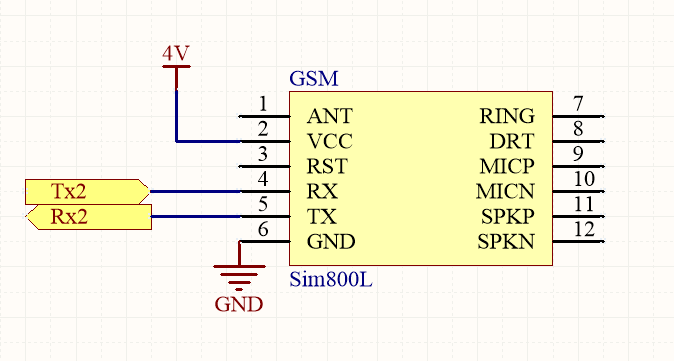
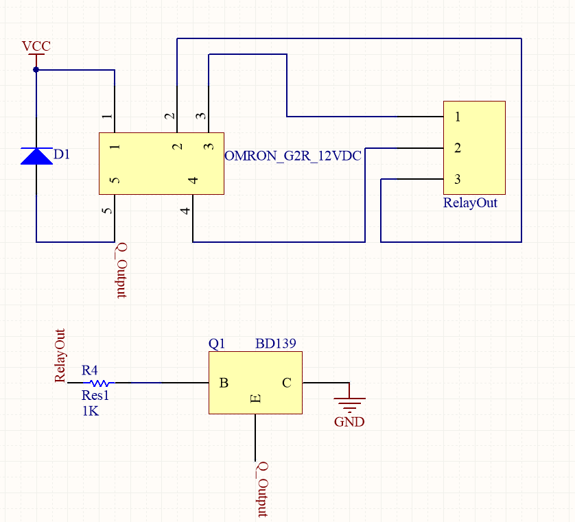
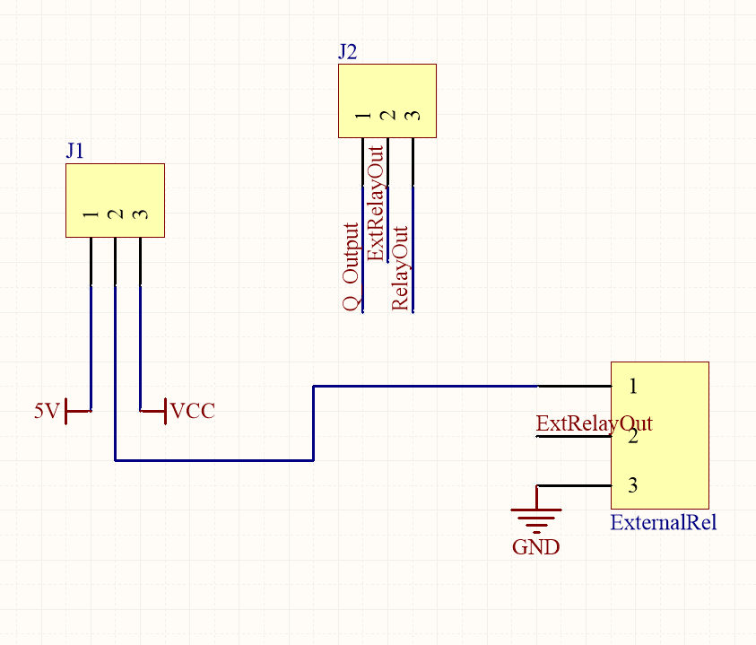

# Hardware Overview

The controller's hardware connects an Arduino Nano to a SIM800L GSM module,
regulated power rails, relay-control circuitry, and pump feedback. Together,
these components allow the firmware to receive SMS commands, switch the pump
circuit, and check its operating state.

## Main components

| Component | Role |
|---|---|
| Arduino Nano | Processes SMS commands, controls the relay output, and reads pump feedback. |
| SIM800L GSM module | Receives command messages and sends status or alert messages over the cellular network. |
| Power regulation | Provides the voltage rails used by the controller and GSM circuitry. |
| Relay and driver | Switches the pump-control circuit in response to the Arduino output. |
| Feedback connection | Returns a pump-state signal to the controller for monitoring. |
| Custom PCB | Integrates the controller, modem, power, relay, and external connections. |

## Circuit schematic

The schematic is divided into functional sections for easier reference:

### Complete circuit

### Power regulation

The power section shows the input connection, LM2596 adjustable buck
converter, and LM7805 regulator used to provide the circuit's supply rails.

### GSM interface

The SIM800L module is connected to the controller's serial signals and its
power and ground connections.

### Relay driver and switched output

The relay section shows the relay, transistor driver, and associated
connections for the relay output.

### External connections

The external connection diagram shows the board's supply and relay-related
connectors.

## PCB layout

The PCB places the Arduino and GSM connections alongside the power, relay,
and feedback circuitry in a single assembly.

## Electrical safety

The project interfaces with a 220 V AC pump installation. Mains wiring,
protective devices, contactor selection, enclosure design, isolation, and
installation must be handled in accordance with applicable electrical safety
requirements. Mains work should be performed by a qualified professional.
