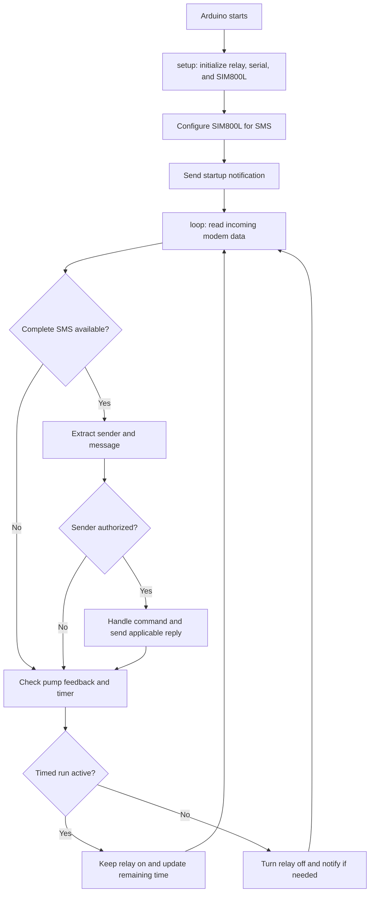

# Firmware Software Flow

The firmware runs on an Arduino Nano and uses a SIM800L GSM module to receive
SMS commands and send operating updates. It controls the pump through a relay
and checks pump feedback through an analog input.

## Firmware structure

| File | Responsibility |
|---|---|
| [`SMS_Pump.ino`](../firmware/SMS_Pump.ino) | Arduino entry point; forwards `setup()` and `loop()` to the controller. |
| [`PumpController.h`](../firmware/PumpController.h) | Declares the controller setup and loop functions. |
| [`PumpController.cpp`](../firmware/PumpController.cpp) | Initializes the system and handles incoming SMS, commands, timers, notifications, and pump-state validation. |
| [`SmsService.h`](../firmware/SmsService.h) | Declares the SIM800L serial interface and SMS sending function. |
| [`SmsService.cpp`](../firmware/SmsService.cpp) | Configures the SIM800L serial connection and sends SMS messages. |

## Main flow

## Startup and communications

At startup, the controller configures digital pin 13 as the relay output,
starts the USB serial console at 115200 baud, and starts the SIM800L connection
at 9600 baud on the software serial interface. It configures the modem for
SMS text mode and incoming-message notifications, then sends a restart SMS.

The loop reads modem data and extracts the sender number and message. A command
is processed only when its sender matches one of the phone numbers configured
in `PumpController.cpp`. Replace the masked example numbers with the intended
authorized numbers before deployment.

## SMS commands

| Command | Behavior |
|---|---|
| `ONmmm` | Energize the relay and set a run timer in minutes, where `mmm` is a three-digit duration (for example, `ON030`). |
| `ONX` | Energize the relay for continuous operation until an `OFF` command or another control condition turns it off. |
| `OFF` | Turn off the relay and report the pump feedback state. |
| `CH` | Reply with relay state, pump feedback state, and remaining time when a timed run is active. |
| `N1` | Enable command confirmation notifications. |
| `N0` | Disable command confirmation notifications. |

Commands and phone numbers are checked by the controller before handling. The
controller uses the pump feedback input to report whether the pump appears to
be running after a relay command.

## Timer and fault monitoring

For a timed run, the controller keeps the relay on while decrementing the
remaining duration approximately once per minute. When the timer expires, it
turns the relay off and sends an automatic-stop notification when notifications
are enabled.

The controller also compares relay output pin 13 with pump feedback on analog
input A0. A mismatch can trigger an error notification; the feedback is
interpreted using the firmware's threshold of 512. The modem interface sends
outgoing messages through the shared `SendSMS` service.
